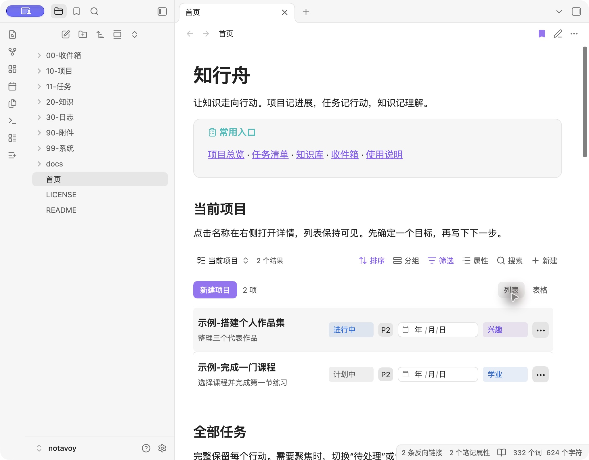
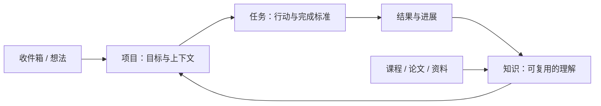

# 知行舟 · NotaVoy

**让知识走向行动。**

一个把项目、任务与知识放在一起的中文 Obsidian 工作台。项目保存目标与上下文，任务记录下一步行动，知识笔记沉淀可以再次使用的理解。

*An Obsidian workspace for turning notes into action. Projects, tasks, learning and knowledge, connected through local Markdown files.*

[开始使用](#开始使用) · [完整指南](99-系统/使用说明.md) · [定制与开发](docs/开发与定制.md) · [MIT](LICENSE) · [English quick start](#english-quick-start)



## 可以做什么

- **项目与任务**：简洁列表、完整表格与状态看板；修改分类、状态、优先级和截止日期；在右侧打开详情。
- **项目上下文**：目标、完成标准、进展记录与下一步放在同一页；关联任务和参考知识自动汇总。
- **资料与灵感**：在项目内收集链接、课程与想法，记录学习位置；支持调整分段和条目顺序。
- **学习与知识**：随手想法、课程与播客、开源项目收藏、论文阅读卡片、主题地图，分别使用合适的模板与视图。
- **本地文件**：正文和属性保存在 Markdown 中，视图保存在 `.base` 文件中；随附插件源码，无需构建。



## 开始使用

1. 安装 **Obsidian 1.14.4 或更新版本**。这是本项目的兼容基线。
2. 点击本仓库的 **Use this template** 创建自己的仓库，或通过 **Code → Download ZIP** 下载并解压。也可以执行：

   ```sh
   git clone https://github.com/huakh/notavoy.git
   ```

3. 在 Obsidian 中选择 **打开文件夹作为仓库**，选中包含 `首页.md`、`99-系统` 和 `.obsidian` 的 `notavoy` 文件夹。
4. 在 **设置 → 第三方插件 / 社区插件** 中关闭受限模式，启用随附的 **项目与任务**。它已经位于 `.obsidian/plugins/project-tasks`，不需要在插件市场搜索。确认核心插件 **数据库（Bases）**、**模板**、**日记** 和 **书签** 已开启。
5. 打开 **首页**。先查看 `示例-搭建个人作品集`，再点击 **新建项目**，写下自己的目标。

`.obsidian` 是隐藏文件夹。移动或复制模板时需要一并保留；Mac 的 Finder 可以用 `⌘⇧.` 显示隐藏文件。

所有 `示例-` 笔记都是虚构演示，可以删除。示例日期留空，避免下载后立即出现过期任务。论文卡片只是占位记录，不对应真实论文。

## 一套工作流，一份数据

| 想做的事 | 从哪里开始 | 保存在哪里 |
| --- | --- | --- |
| 推进一个目标 | 首页 → 新建项目 | `10-项目` |
| 追踪具体行动 | 项目页 → 新建本项目任务，或首页 → 新建任务 | `11-任务` |
| 快速记录想法 | 首页 → 随手想法 → 新建 | `00-收件箱/想法` |
| 学习课程、收听播客 | 首页 → 课程与播客 → 新建 | `20-知识/学习` |
| 收藏开源工具 | 首页 → 兴趣项目 → 新建 | `20-知识/开源项目` |
| 阅读论文 | 首页 → 未读论文 → 新建 | `20-知识/论文` |
| 整理主题与理解 | 新建笔记，再插入主题或知识笔记模板 | `20-知识/主题`、`20-知识/笔记` |

项目正文中的普通复选框适合临时检查事项；需要状态、优先级或截止日期的行动，使用独立任务笔记。项目进度是手动填写的 0–100 数值。截止日期用于筛选和展示，不会发送提醒。

## 目录结构

```text
notavoy/
├── 首页.md
├── 00-收件箱/          临时内容与随手想法
├── 10-项目/            目标、上下文、资料与进展
├── 11-任务/            独立行动与结果
├── 20-知识/
│   ├── 学习/           课程与播客
│   ├── 开源项目/       工具收藏与试用记录
│   ├── 论文/           阅读记录
│   ├── 主题/           主题地图
│   └── 笔记/           可复用的理解
├── 30-日志/            日常记录
├── 90-附件/            自己添加的 PDF、图片等
├── 99-系统/
│   ├── 模板/           9 种笔记模板
│   ├── 数据库/         9 个 Bases 数据库
│   └── 使用说明.md
├── .obsidian/          通用设置、样式和项目与任务插件
└── docs/               定制与开发说明
```

## 定制、同步与公开范围

在 **设置 → 项目与任务** 中调整分类、状态和优先级。目录名、属性名和部分章节标题是插件与数据库共同使用的约定；修改它们前请阅读[定制指南](docs/开发与定制.md)。

模板不配置云盘、同步账号或自动备份。可以自行选择备份方式；GitHub 的模板按钮也不会自动同步本地笔记。

本仓库只包含通用配置、插件源码和虚构示例，不包含原始个人笔记、论文附件、备份路径或账号配置。`.gitignore` 默认忽略数据目录中新建的个人内容、附件、插件运行配置和窗口状态。若希望用 Git 同步自己的笔记，请先选择合适的仓库可见性，再调整对应忽略规则。**已被 Git 跟踪的示例或配置不会因为忽略规则而停止跟踪**；直接把示例改成私人笔记后仍可能被提交。

## 实现与贡献

基于 [Obsidian Bases](https://help.obsidian.md/bases) 与 [Bases 扩展 API](https://docs.obsidian.md/plugins/guides/bases-view)。项目与任务插件的入口是 [main.js](.obsidian/plugins/project-tasks/main.js)，样式是 [styles.css](.obsidian/plugins/project-tasks/styles.css)。日常使用不需要 Node.js、Dataview 或 Templater。

已在 **macOS / Obsidian 1.14.5** 验证项目与任务创建、关联、自动模板、资料与灵感记录、分段排序和删除撤销。

欢迎提交 Issue 或 Pull Request。描述问题时请提供 Obsidian 版本、操作步骤和虚构的最小示例；开发请使用单独的测试库。当前界面以中文为主，移动端和其他桌面平台尚未验证。

## English quick start

NotaVoy (知行舟) is a Chinese-first Obsidian vault template. It connects projects, task notes, learning records and reusable knowledge using native Bases and a bundled local plugin.

1. Use this GitHub template, download the ZIP, or clone the repository.
2. Open the repository folder as a vault in Obsidian **1.14.4+**. Keep the hidden `.obsidian` directory.
3. Enable the bundled **项目与任务** community plugin and the **Bases** core plugin.
4. Open `首页.md`. Notes starting with `示例-` are fictional examples and can be removed.

No build step or cloud account is required. New personal notes and attachments are ignored by Git by default; tracked examples remain tracked after editing. Keep the Chinese folder/property names unless you also update the plugin and Bases definitions. Mobile and non-macOS platforms have not been verified.

## License

[MIT](LICENSE) © 2026 [huakh](https://github.com/huakh). Obsidian itself is distributed separately under its own terms.
